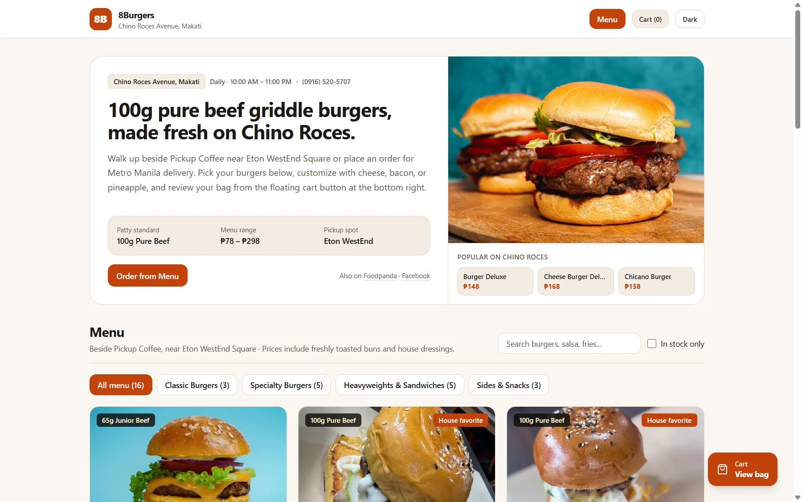
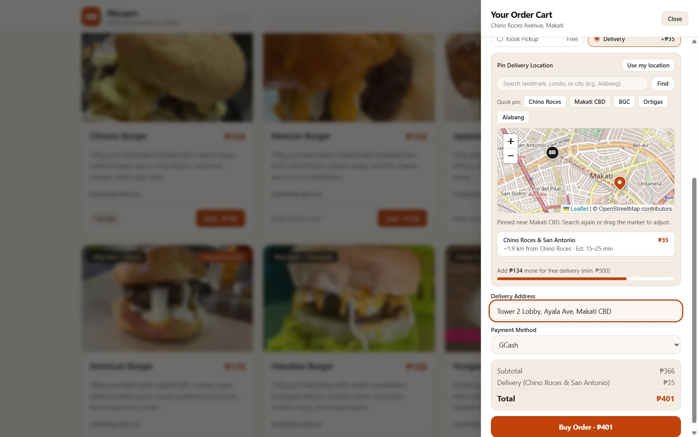
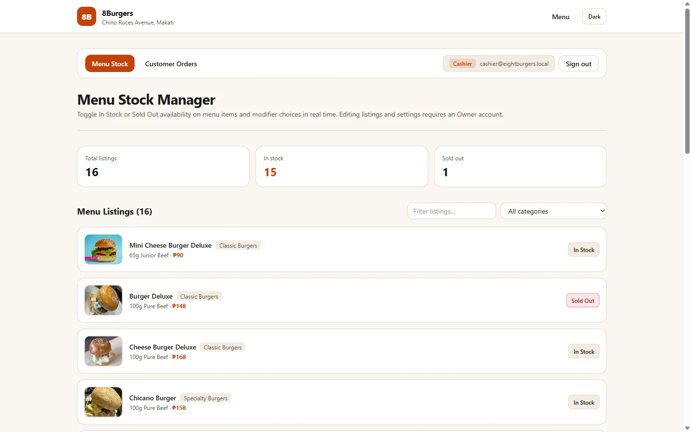

# Eight Burgers (Chino Roces Avenue)

Full-stack ordering storefront, role-protected Staff Portal console, REST BFF, and local Supabase PostgreSQL 17 backend for **8Burgers — Chino Roces Avenue, Makati**, built as an npm workspaces monorepo (`apps/web`, `apps/api`, `packages/contracts`, `supabase/`).



## Implemented Capabilities

- **Storefront (`apps/web`, `/`)**: Live PostgreSQL-backed menu and Metro Manila delivery pricing fetched via `GET /api/v1/catalog` and cached in TanStack Query v5. Includes self-hosted WebP imagery (`apps/web/public/images/menu/`), category filtering, keyword search, in-stock filter, burger add-ons (_Sliced Cheese +₱20_, _Crispy Bacon +₱20_, _Extra Veggies +₱26_, _Grilled Pineapple +₱26_), and instant add-to-cart actions.
- **Floating Cart & Server-Verified Checkout**: Local cart persistence (`apps/web/src/shared/store/useCartStore.ts`) stores only non-sensitive cart line items under `eight-burgers:cart:v2` and automatically migrates/purges legacy `eight-burgers:state:v1` guest PII. Submitting an order calls `POST /api/v1/orders` with a per-attempt `Idempotency-Key`; PostgreSQL `place_order(...)` calculates authoritative totals, delivery zones/waivers, and atomic `#8B-101+` queue numbers inside a single transaction.
- **Staff Portal (`apps/web`, `/admin`)**: Protected by server-backed Supabase Auth + `public.admin_users` allowlist + `HttpOnly; SameSite=Lax; Path=/api` session cookies (`AdminAuthGuard` + `AdminLoginForm`) with role-based access control (`owner`, `cashier`, `staff`) enforced across PostgreSQL RLS/triggers, API routes, and UI. `owner` manages live menu CRUD, WebP photo uploads, default menu restoration, Metro Manila delivery zones & free-delivery threshold, customer orders, and the **Team & Roles** tab (`/admin/team`) to register Cashier/Staff logins, change roles, or disable accounts; `cashier` and `staff` manage live customer orders (all stages including `cancelled`) and menu `In Stock / Sold Out` toggles with optimistic concurrency checks (`409 Conflict` on stale updates).
- **REST BFF (`apps/api`, Hono + Node 22)**: Same-origin `/api/v1/*` API proxied by Vite in local dev, enforcing CSRF (`Origin` + `X-Requested-With: fetch`), sliding-window rate limits (`429` + `Retry-After`), RFC 9457 Problem Details (`application/problem+json`), SHA-256 guest receipt tokens (`X-Order-Receipt-Token`), and user-scoped JWT forwarding so PostgreSQL Row-Level Security executes on every admin operation.
- **Shared Contracts (`packages/contracts`)**: Single source of truth for Zod v4 schemas, domain types, and pure Haversine/delivery pricing math shared across `apps/web` and `apps/api`.

## Screenshots

| Cart & Delivery Map                                                                     | Order Receipt & Live Tracker                                                             |
| --------------------------------------------------------------------------------------- | ---------------------------------------------------------------------------------------- |
|  |  |

| Owner — Menu & Delivery Console                                                 | Staff Portal — Live Customer Orders                                       |
| ------------------------------------------------------------------------------- | ------------------------------------------------------------------------- |
|  |  |

| Cashier — Menu Stock Manager                                              | Owner — Team & Roles (`/admin/team`)                                      |
| ------------------------------------------------------------------------- | ------------------------------------------------------------------------- |
|  |  |

## Screenshots

| Cart & Delivery Map                                                                     | Order Receipt & Live Tracker                                                             |
| --------------------------------------------------------------------------------------- | ---------------------------------------------------------------------------------------- |
|  |  |

| Owner — Menu & Delivery Console                                                 | Staff Portal — Live Customer Orders                                       |
| ------------------------------------------------------------------------------- | ------------------------------------------------------------------------- |
|  |  |

| Cashier — Menu Stock Manager                                              | Owner — Team & Roles (`/admin/team`)                                      |
| ------------------------------------------------------------------------- | ------------------------------------------------------------------------- |
|  |  |

## Technology stack

- **Frontend (`apps/web`)** — React 19, TypeScript, Vite 8, Tailwind CSS v4, React Router, TanStack Query v5, Zustand, and Immer.
- **Backend (`apps/api`)** — Hono, `@hono/node-server`, `@supabase/supabase-js`, Sharp, and Zod v4.
- **Database (`supabase/`)** — Local Supabase CLI + PostgreSQL 17 with migrations, Row-Level Security, and atomic SQL RPCs.
- **Testing & tooling** — Vitest, React Testing Library, Oxlint, and Prettier.

## Install

Use Node.js **22.22.2+** (matching [CI](./.github/workflows/ci.yml)), Docker Desktop (for local Supabase), and npm.

Install workspace dependencies from the repository root:

```sh
npm ci
```

Use `npm install` when updating dependencies. If PowerShell blocks `npm` or `npx` launchers, use `npm.cmd` or `npx.cmd`.

## Local Database & Backend Setup

1. Start and seed the local Supabase PostgreSQL 17 stack (requires Docker):

   ```sh
   npm run db:start
   npm run db:reset
   npm run db:status
   ```

   `npm run db:reset` applies all migrations in `supabase/migrations/` and seeds:
   - `supabase/seeds/catalog.sql` — 16 Chino Roces menu items, 4 add-ons, store settings, and 5 Metro Manila delivery zones.
   - `supabase/seeds/dev_admin.sql` — local-dev-only Staff Portal accounts (all share password `EightBurgersDev123!`). **Never apply `dev_admin.sql` to staging or production.**
     - **Owner**: `owner@eightburgers.local` / `EightBurgersDev123!` — full Menu CRUD, photos, Delivery settings, Customer Orders, and Team & Roles (`/admin/team`).
     - **Cashier**: `cashier@eightburgers.local` / `EightBurgersDev123!` — Customer Orders and Menu `In Stock / Sold Out` toggles.
     - **Staff**: `staff@eightburgers.local` / `EightBurgersDev123!` — Customer Orders and Menu `In Stock / Sold Out` toggles.

2. Copy the local `anon key` and `service_role key` from `npm run db:status` into a gitignored `apps/api/.env.local` file (see [.env.example](./.env.example)):

   ```env
   PORT=8787
   APP_ORIGIN=http://localhost:5173
   COOKIE_SECURE=false
   SUPABASE_URL=http://127.0.0.1:54321
   SUPABASE_ANON_KEY=<anon-key-from-db-status>
   SUPABASE_SERVICE_ROLE_KEY=<service-role-key-from-db-status>
   ```

3. Run both the REST BFF (`http://127.0.0.1:8787`) and Vite storefront (`http://localhost:5173`):

   ```sh
   npm run dev
   ```

   - Storefront: <http://localhost:5173/>
   - Staff Portal: <http://localhost:5173/admin>
   - Local Supabase Studio: <http://127.0.0.1:54323/>
   - Local Mailpit: <http://127.0.0.1:54324/>

## Environment configuration

Environment variables are documented in [.env.example](./.env.example):

- `VITE_API_BASE_URL` (`/api/v1` by default): Public relative API base path proxied to `http://127.0.0.1:8787` during local development.
- `VITE_HIDE_PUBLIC_ADMIN` (`false` by default): Optional UI toggle to hide the `"Staff Portal"` header link. Access control is always enforced server-side on `/api/v1/admin/*` via `HttpOnly` session cookies and PostgreSQL RLS.
- `SUPABASE_URL`, `SUPABASE_ANON_KEY`, `SUPABASE_SERVICE_ROLE_KEY`: Server-only credentials consumed exclusively by `apps/api` (never prefixed with `VITE_`).

## Project structure

```text
apps/
  api/                  Hono REST BFF (@eight-burgers/api) on :8787
  web/                  Vite + React 19 storefront & admin SPA (@eight-burgers/web) on :5173
packages/
  contracts/            Shared Zod v4 schemas, types, and pricing math (@eight-burgers/contracts)
supabase/
  config.toml           Local Supabase CLI config (PostgreSQL 17)
  migrations/           Versioned SQL schema, RLS policies, and place_order() RPCs
  seeds/                Split catalog.sql (idempotent) and dev_admin.sql (local-only)
docs/                   Domain-agnostic engineering guides for this stack
.agents/skills/         Stack- and repo-agnostic workflow skills (+ conditional stack checklists)
```

## Checks and builds

| Command                | Purpose                                              |
| ---------------------- | ---------------------------------------------------- |
| `npm run dev`          | Run `apps/api` (`:8787`) and `apps/web` (`:5173`)    |
| `npm run db:start`     | Start local Supabase Docker stack                    |
| `npm run db:reset`     | Rebuild local Postgres 17 from migrations and seeds  |
| `npm run db:status`    | Print local Supabase URLs and API keys               |
| `npm run db:lint`      | Lint local PostgreSQL schema and functions           |
| `npm run db:stop`      | Stop local Supabase Docker containers                |
| `npm run lint`         | Lint all workspaces with Oxlint                      |
| `npm run format:check` | Check formatting across the repository with Prettier |
| `npm run test`         | Run Vitest suites across all workspaces              |
| `npm run typecheck`    | Run TypeScript type-checking across all workspaces   |
| `npm run build`        | Build all workspaces                                 |
| `npm run preview`      | Serve the built `apps/web` preview                   |
| `npm run format`       | Format repository files                              |

[CI](./.github/workflows/ci.yml) runs on pull requests targeting `main` and pushes to `main` without requiring Docker or live cloud credentials. It installs with `npm ci`, then runs `lint`, `format:check`, `test`, `typecheck`, and `build`.

## Documentation

- [Architecture](./docs/architecture.md) — Layering, boundaries, routing, and deployment
- [Coding standards](./docs/coding-standards.md) — TypeScript, naming, imports, and formatting
- [Feature structure](./docs/feature-structure.md) — Feature ownership, public APIs, and translations
- [State management](./docs/state-management.md) — Local, client, server, form, and URL state
- [API design](./docs/api-design.md) — API clients, queries, mutations, and server routes
- [Database and storage](./docs/database-and-storage.md) — PostgreSQL schema, migrations, RLS, RPCs, storage, and seeds
- [Component guidelines](./docs/component-guidelines.md) — Reusable UI, hooks, and accessibility
- [Performance](./docs/performance.md) — Profiling, complexity, rendering, and loading limits
- [Testing strategy](./docs/testing-strategy.md) — Test coverage, local checks, CI, and release checks
- [Security](./docs/security.md) — Authorization, credentials, and data handling

## Contributing

Use short lowercase commit subjects.
Complete the checklist in [the pull request template](./.github/PULL_REQUEST_TEMPLATE.md), record checks actually run, and include screenshots for visible UI changes.
For AI-assisted development, start with [AGENTS.md](./AGENTS.md) and open the guides relevant to the task.
