# Menu Kiosk

White-label ordering storefront, role-protected Staff Portal, REST BFF, and PostgreSQL 17 (Supabase) backend for Philippine food & beverage shops (restaurants, cafes, milk tea shops, bakeries, and cloud kitchens), built as an npm workspaces monorepo (`apps/web`, `apps/api`, `packages/contracts`, `supabase/`).

Each shop deploys its own instance and Supabase project configured entirely through `/admin/settings` and the interactive `npm run shop:init` bootstrap CLI—with zero source-code edits required—while keeping the **8Burgers Chino Roces** dataset available as the default local demo seed.


## Implemented Capabilities

- **Dynamic White-Label Storefront (`apps/web`, `/`)**: Live PostgreSQL-backed store profile, uploaded logo & hero banner (with a clean typographic fallback when no hero image is set), curated WCAG-AA accent theme presets (`ember`, `espresso`, `matcha`, `berry`, `ocean`, `charcoal`) plus contrast-clamped custom hex colors with light/dark parity, manual **Accepting Orders (Open / Paused)** status banner (allowing browsing and bag building while disabling checkout), dynamic `menu_categories`, reusable single/multi-select `option_groups`, `"From ₱X"` display pricing when required options add a fee, and per-item special notes (`itemNote`, up to 140 characters).
- **Floating Cart, Dine-in Table QR & Payment Verification**: Local cart persistence (`menu-kiosk:cart:v3`) stores only non-sensitive line items (`selectedOptionIds` + `itemNote`) with automatic one-time migration/purge of legacy keys; stale lines with sold-out options stay visible with an inline **"Edit options"** repair action. Supports configurable **Pickup**, **Delivery** (PH address autocomplete biased around the shop's configured pin + device geolocation + distance-formula pricing & free-delivery waiver), and **Dine-in** (`/?fulfillment=dine-in&table=7` persisted in `sessionStorage` with a dismissible table banner). Payment checkout supports configurable **Cash**, **GCash**, **Maya**, and **Bank Transfer** with copyable account details, lossless WebP QR images, and optional payment reference submission both at checkout and post-checkout via opaque `sessionStorage` receipt tokens (zero customer PII).
- **Staff Portal (`apps/web`, `/admin`)**: Protected by server-backed Supabase Auth + `public.admin_users` allowlist + `HttpOnly; SameSite=Lax; Path=/api` session cookies (`mk_access_token` / `mk_refresh_token`) with three roles enforced across PostgreSQL RLS/triggers, API middleware, and UI:
  - **Owner**: Store Profile, Branding & Theme, Shop Origin Pin, Fulfillment & Payment QR, Printable Table QR Generator (`/admin/settings`), Categories, Option Groups & Menu Item CRUD (`/admin`), Customer Orders & Payment Confirmation (`/admin/orders`), Team & Roles (`/admin/team`), and a dismissible **Shop Setup Checklist** for fresh shops.
  - **Cashier**: Toggle **Accepting Orders / Closed Notice**, confirm or revert order `paymentStatus` (including Cash), advance kitchen `status` (`received` → `preparing` → `ready` → `completed` / `cancelled`), and toggle item & option-choice availability.
  - **Staff**: Advance kitchen `status` and toggle item & option-choice availability (`In Stock / Sold Out`).
- **REST BFF (`apps/api`, Hono + Node 22)**: Same-origin `/api/v1/*` API enforcing CSRF (`Origin` + `X-Requested-With: fetch`), trusted-proxy IP extraction (`TRUST_PROXY`), bounded sliding-window rate limits with per-account login throttling, RFC 9457 Problem Details (`application/problem+json`), dedicated HMAC receipt signing (`RECEIPT_SIGNING_SECRET`), Sharp WebP asset optimization (including lossless `payment-qr` encoding and cross-URL orphan cleanup), single-RPC admin stage counts, and user-scoped JWT forwarding so PostgreSQL RLS runs on every admin write.
- **Shared Contracts (`packages/contracts`)**: Pure Zod v4 schemas, WCAG-AA accent token resolver, option validation & `"From ₱X"` pricing helpers, and Haversine/distance-formula delivery math shared across `apps/web` and `apps/api`.

## Screenshots (8Burgers Demo Seed)

| Item Customizer Modal                                                                                           | Cart & Delivery Address Search                                                                                                     |
| --------------------------------------------------------------------------------------------------------------- | ---------------------------------------------------------------------------------------------------------------------------------- |
| 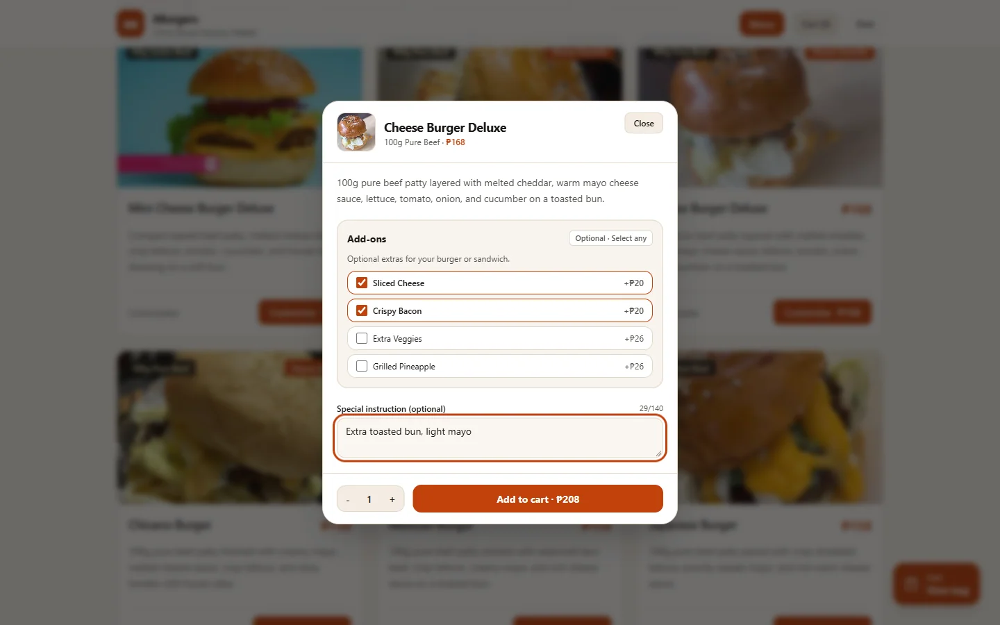 | 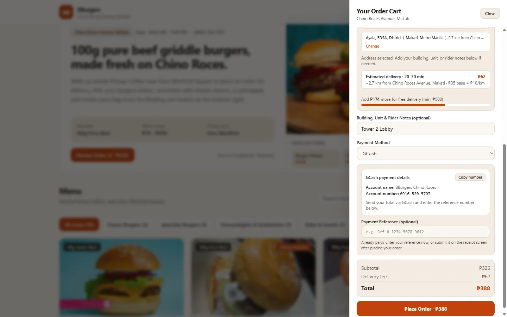 |

| Order Receipt & Live Tracker                                                                                               | Checkout — Pickup-Only Mode & Active Order Tab                                                                         |
| -------------------------------------------------------------------------------------------------------------------------- | ---------------------------------------------------------------------------------------------------------------------- |
| 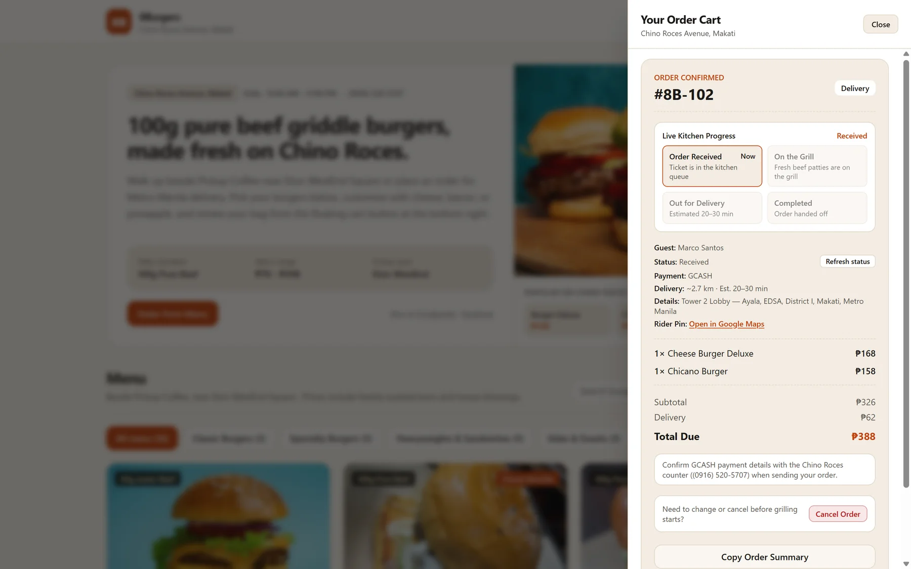 | 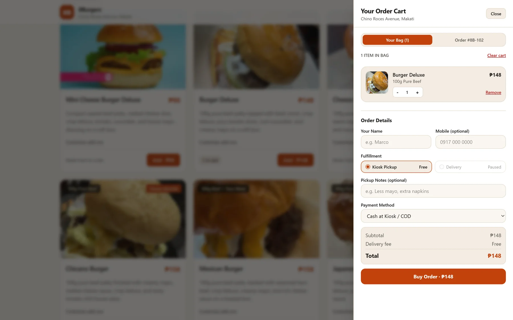 |

| Owner — Store Branding & WCAG-AA Theme (`/admin/settings`)                                                        | Owner — Dine-in Table QR Generator (`/admin/settings`)                                     |
| ----------------------------------------------------------------------------------------------------------------- | ------------------------------------------------------------------------------------------ |
| 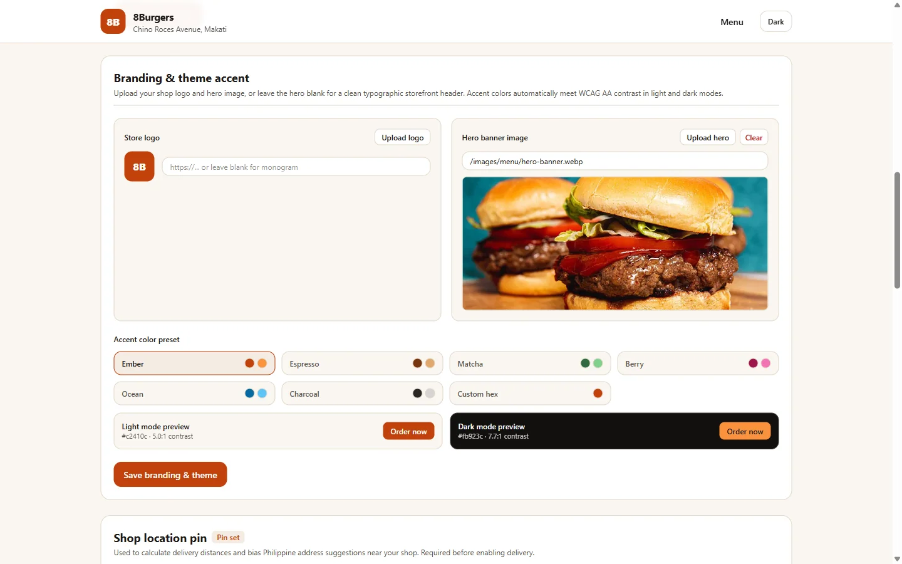 | 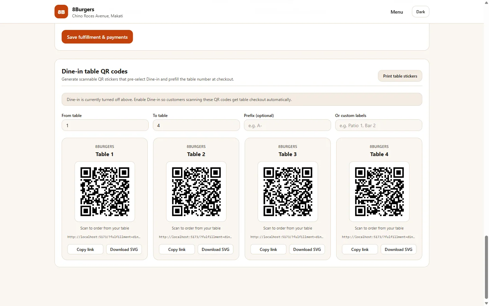 |

| Owner — Menu & Delivery Console (`/admin`)                                      | Owner — Categories & Option Groups (`/admin`)                                                                 |
| ------------------------------------------------------------------------------- | ------------------------------------------------------------------------------------------------------------- |
| 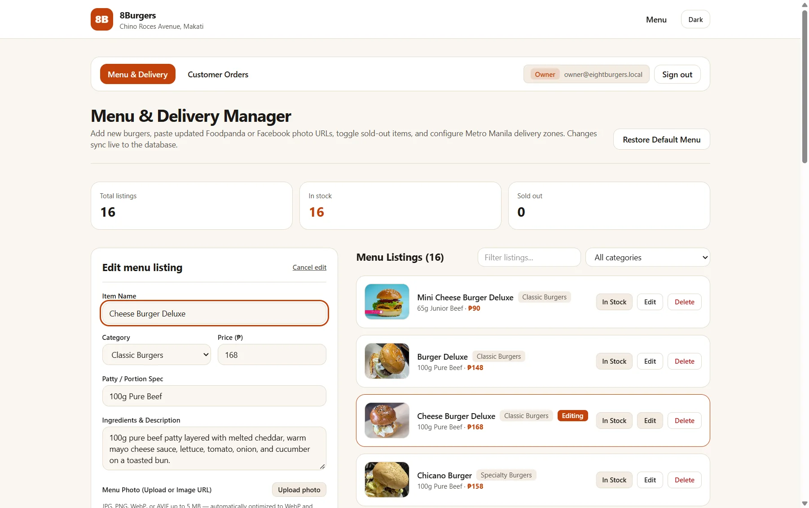 | 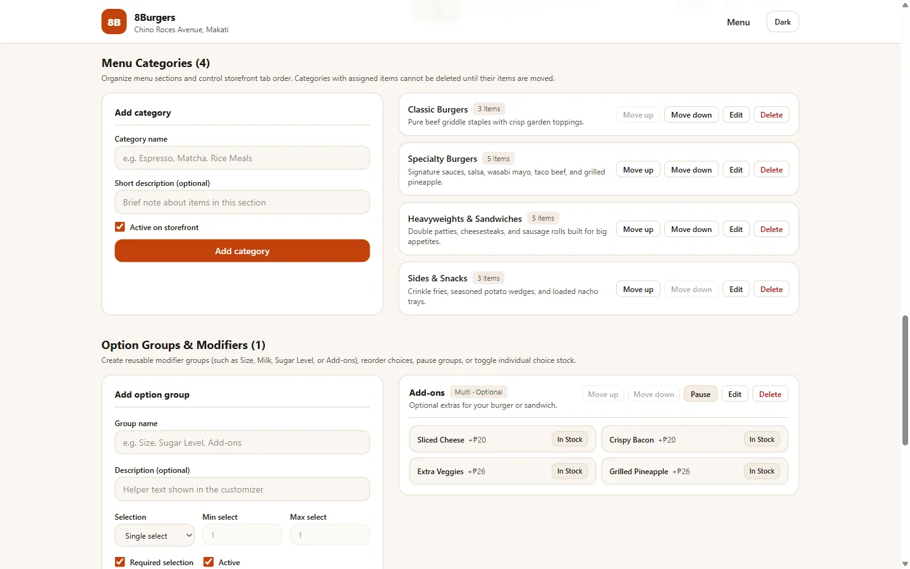 |

| Owner — Distance-Formula Delivery Pricing                                                                   | Staff Portal — Live Customer Orders (`/admin/orders`)                                                                  |
| ----------------------------------------------------------------------------------------------------------- | ---------------------------------------------------------------------------------------------------------------------- |
| 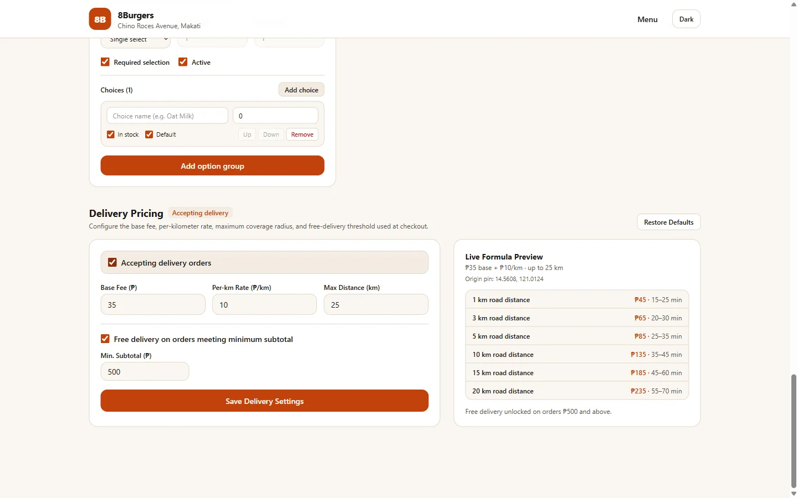 | 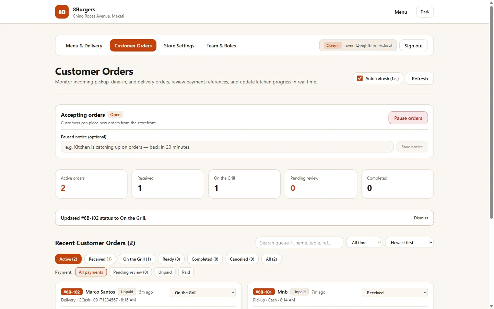 |

| Cashier — Menu Stock Manager (`/admin`)                                   | Owner — Team & Roles (`/admin/team`)                                      |
| ------------------------------------------------------------------------- | ------------------------------------------------------------------------- |
|  | 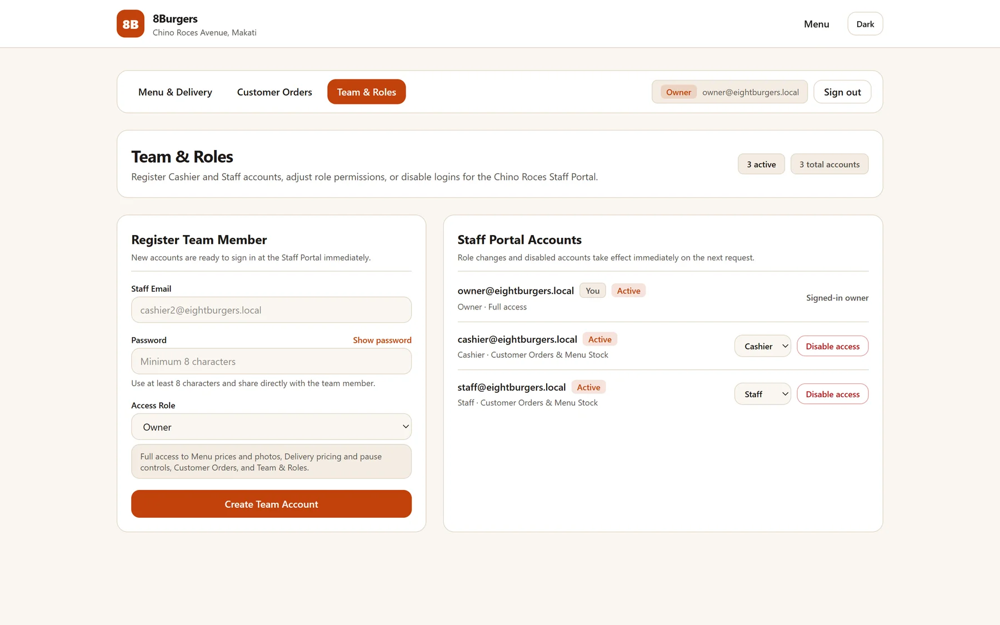 |

## Technology Stack

- **Frontend (`apps/web`)** — React 19, TypeScript, Vite 8, Tailwind CSS v4, React Router, TanStack Query v5, Zustand, Immer, and `qrcode` (lazy-loaded in `/admin/settings`).
- **Backend (`apps/api`)** — Hono, `@hono/node-server`, `@supabase/supabase-js`, Sharp, and Zod v4.
- **Database (`supabase/`)** — Local Supabase CLI + PostgreSQL 17 with append-only migrations, Row-Level Security, column-level role guards, Storage policies, and atomic SQL RPCs.
- **Testing & Tooling** — Vitest, React Testing Library, Oxlint, and Prettier.

## Install

Use Node.js **22.22.2+** (matching [CI](./.github/workflows/ci.yml)), Docker Desktop (for local Supabase), and npm.

Install workspace dependencies from the repository root:

```sh
npm ci
```

Use `npm install` when updating dependencies. If PowerShell blocks `npm` or `npx` launchers, use `npm.cmd` or `npx.cmd`.

## Local Database & Backend Setup (Demo Seed)

1. Start and seed the local Supabase PostgreSQL 17 stack (requires Docker):

   ```sh
   npm run db:start
   npm run db:reset
   npm run db:status
   ```

   `npm run db:reset` applies all migrations in `supabase/migrations/` and seeds the local default demo dataset configured in [supabase/config.toml](./supabase/config.toml):
   - `supabase/seeds/catalog.sql` — idempotent 8Burgers Chino Roces demo profile, 4 categories, reusable `add-ons` option group, 16 menu items, and distance-formula delivery settings.
   - `supabase/seeds/dev_admin.sql` — local-dev-only Staff Portal accounts (all share password `EightBurgersDev123!`). **Never apply `dev_admin.sql` to staging or production.**
     - **Owner**: `owner@eightburgers.local` / `EightBurgersDev123!`
     - **Cashier**: `cashier@eightburgers.local` / `EightBurgersDev123!`
     - **Staff**: `staff@eightburgers.local` / `EightBurgersDev123!`

2. Copy the local `anon key` and `service_role key` from `npm run db:status` into a gitignored `apps/api/.env.local` file (see [.env.example](./.env.example)):

   ```env
   PORT=8787
   APP_ORIGIN=http://localhost:5173
   COOKIE_SECURE=false
   TRUST_PROXY=false
   ENABLE_DEMO_RESET=true
   SUPABASE_URL=http://127.0.0.1:55321
   SUPABASE_ANON_KEY=<anon-key-from-db-status>
   SUPABASE_SERVICE_ROLE_KEY=<service-role-key-from-db-status>
   ```

3. Run both the REST BFF (`http://127.0.0.1:8787`) and Vite storefront (`http://localhost:5173`):

   ```sh
   npm run dev
   ```

   - Storefront: <http://localhost:5173/>
   - Staff Portal: <http://localhost:5173/admin>
   - Local Supabase Studio: <http://127.0.0.1:55323/>
   - Local Mailpit: <http://127.0.0.1:55324/>

## Deploying for a New Shop

Deploy a brand-new white-label storefront without editing any application source files:

1. **Provision Supabase & Apply Migrations**
   - Create a Supabase project (PostgreSQL 17) and push all migrations under `supabase/migrations/` (`npx supabase db push`).
   - Do **not** run `supabase/seeds/dev_admin.sql` in staging or production. Optionally apply `supabase/seeds/blank.sql` for an idempotent blank `store_settings` row (Pickup-only, Cash enabled, `origin_lat = null`, `origin_lng = null`, zero categories or menu items), or let `npm run shop:init` write the initial shop profile directly.

2. **Bootstrap the Shop & Initial Owner Account (`npm run shop:init`)**
   - `scripts/init-shop.mjs` uses Supabase Auth Admin + PostgREST REST APIs over `SUPABASE_URL` and `SUPABASE_SERVICE_ROLE_KEY` (**no `psql` required**; works identically against hosted Supabase Cloud and local Supabase).
   - Interactive mode:

     ```sh
     SUPABASE_URL=https://<project-ref>.supabase.co \
     SUPABASE_SERVICE_ROLE_KEY=<service-role-key> \
     npm run shop:init
     ```

   - Non-interactive mode (CI / automation):

     ```sh
     SUPABASE_URL=https://<project-ref>.supabase.co \
     SUPABASE_SERVICE_ROLE_KEY=<service-role-key> \
     npm run shop:init -- \
       --non-interactive \
       --owner-email owner@yourshop.ph \
       --owner-password "ChangeMeStrongPass123!" \
       --store-name "Kape Kanto" \
       --branch "IT Park, Cebu City" \
       --queue-prefix KK \
       --seed=blank
     ```

   - Use `--seed=demo` instead of `--seed=blank` if you want to preload the 8Burgers sample catalog for staging or evaluation.

3. **Configure Production Environment Variables**
   - Set all server-only secrets in your API hosting environment (see [.env.example](./.env.example)):
     - `NODE_ENV=production`
     - `APP_ORIGIN=https://order.yourshop.ph`
     - `COOKIE_SECURE=true` (and optional `COOKIE_DOMAIN=.yourshop.ph`)
     - `RECEIPT_SIGNING_SECRET`: **required** in production (minimum 32 random characters; never reuse `SUPABASE_SERVICE_ROLE_KEY`)
     - `TRUST_PROXY=true` only when deployed behind a trusted reverse proxy that strips client-supplied `X-Forwarded-For` / `X-Real-IP` headers (defaults to `false`)
     - `ENABLE_DEMO_RESET=false` (default; keeps demo reset endpoints blocked with `403 DEMO_RESET_DISABLED`)
     - `SUPABASE_URL`, `SUPABASE_ANON_KEY`, `SUPABASE_SERVICE_ROLE_KEY`

4. **Finish Setup in `/admin`**
   - Sign in as the Owner at `/admin` and follow the built-in **Shop Setup Checklist**:
     - Configure store identity, logo/hero, WCAG-AA theme accent, and shop origin pin in `/admin/settings`.
     - Enable Pickup, Delivery (after setting the shop pin), or Dine-in (with printable Table QR stickers) and upload GCash / Maya / Bank Transfer QR codes in `/admin/settings`.
     - Create categories, reusable option groups, and menu items in `/admin`.
     - Invite Cashier and Staff accounts in `/admin/team`.

## Environment Configuration

Environment variables are documented in [.env.example](./.env.example):

- `VITE_API_BASE_URL` (`/api/v1` by default): Public relative API base path proxied to `http://127.0.0.1:8787` during local development.
- `VITE_HIDE_PUBLIC_ADMIN` (`false` by default): Optional UI toggle to hide the `"Staff Portal"` header link. Access control is always enforced server-side on `/api/v1/admin/*` via `HttpOnly` session cookies and PostgreSQL RLS.
- `RECEIPT_SIGNING_SECRET`: Server-only HMAC secret for guest receipt tokens (required min 32 chars in production).
- `TRUST_PROXY` (`false` by default): Controls whether `X-Forwarded-For` / `X-Real-IP` headers are trusted for rate-limiting client IP extraction.
- `ENABLE_DEMO_RESET` (`false` by default): Gates `POST /api/v1/admin/menu-items/reset` and `POST /api/v1/admin/delivery-pricing/reset`.
- `SUPABASE_URL`, `SUPABASE_ANON_KEY`, `SUPABASE_SERVICE_ROLE_KEY`: Server-only credentials consumed exclusively by `apps/api` and `scripts/init-shop.mjs` (never prefixed with `VITE_`).

## Project Structure

```text
apps/
  api/                  Hono REST BFF (@menu-kiosk/api) on :8787
  web/                  Vite + React 19 storefront & admin SPA (@menu-kiosk/web) on :5173
packages/
  contracts/            Shared Zod v4 schemas, WCAG theme tokens, and pricing math (@menu-kiosk/contracts)
scripts/
  dev.mjs               Local concurrent dev launcher (API + Web)
  init-shop.mjs         REST-only interactive/CLI shop & Owner bootstrapper (`npm run shop:init`)
supabase/
  config.toml           Local Supabase CLI config (PostgreSQL 17, project_id = "menu-kiosk")
  migrations/           Append-only SQL schema, RLS policies, role guards, and atomic RPCs
  seeds/                Split catalog.sql (demo), blank.sql (production blank), and dev_admin.sql (local-only)
docs/                   Domain-agnostic engineering guides for this stack
.agents/skills/         Stack- and repo-agnostic workflow skills (+ conditional stack checklists)
```

## Checks and Builds

| Command                | Purpose                                              |
| ---------------------- | ---------------------------------------------------- |
| `npm run dev`          | Run `apps/api` (`:8787`) and `apps/web` (`:5173`)    |
| `npm run shop:init`    | Bootstrap a new shop profile & Owner over REST APIs  |
| `npm run screenshots`  | Regenerate `docs/screenshots/*.webp` from live dev   |
| `npm run db:start`     | Start local Supabase Docker stack                    |
| `npm run db:reset`     | Rebuild local Postgres 17 from migrations and seeds  |
| `npm run db:status`    | Print local Supabase URLs and API keys               |
| `npm run db:lint`      | Lint local PostgreSQL schema and functions           |
| `npm run db:stop`      | Stop local Supabase Docker containers                |
| `npm run lint`         | Lint all workspaces with Oxlint                      |
| `npm run format:check` | Check formatting across the repository with Prettier |
| `npm run test`         | Run Vitest suites across all workspaces              |
| `npm run typecheck`    | Run TypeScript type-checking across all workspaces   |
| `npm run build`        | Build all workspaces                                 |
| `npm run preview`      | Serve the built `apps/web` preview                   |
| `npm run format`       | Format repository files                              |

[CI](./.github/workflows/ci.yml) runs on pull requests targeting `main` and pushes to `main` without requiring Docker or live cloud credentials. It installs with `npm ci`, then runs `lint`, `format:check`, `test`, `typecheck`, and `build`.

## Documentation

- [Architecture](./docs/architecture.md) — Layering, boundaries, routing, and deployment
- [Coding standards](./docs/coding-standards.md) — TypeScript, naming, imports, and formatting
- [Feature structure](./docs/feature-structure.md) — Feature ownership, public APIs, and translations
- [State management](./docs/state-management.md) — Local, client, server, form, and URL state
- [API design](./docs/api-design.md) — API clients, queries, mutations, and server routes
- [Database and storage](./docs/database-and-storage.md) — PostgreSQL schema, migrations, RLS, RPCs, storage, and seeds
- [Component guidelines](./docs/component-guidelines.md) — Reusable UI, hooks, and accessibility
- [Performance](./docs/performance.md) — Profiling, complexity, rendering, and loading limits
- [Testing strategy](./docs/testing-strategy.md) — Test coverage, local checks, CI, and release checks
- [Security](./docs/security.md) — Authorization, credentials, and data handling

## Contributing

Use short lowercase commit subjects.
Complete the checklist in [the pull request template](./.github/PULL_REQUEST_TEMPLATE.md), record checks actually run, and include screenshots for visible UI changes.
For AI-assisted development, start with [AGENTS.md](./AGENTS.md) and open the guides relevant to the task.
