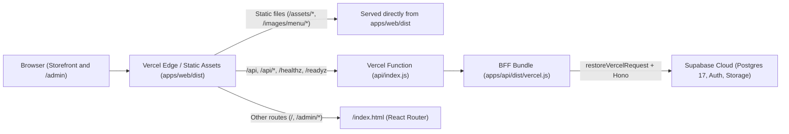

# Supabase & Vercel Deployment Guide

Step-by-step runbook for provisioning a new client **Supabase** project (using the **8Burgers** seed or a blank shop) and deploying the monorepo (`apps/web`, `apps/api`, `packages/contracts`) as a single **Vercel** project.

> [!NOTE]
> For general non-Vercel hosting (VPS + Caddy/Nginx or container platforms), see the [Client Launch Checklist](./client-launch-checklist.md).

---

## 1. Project Naming & Region Conventions

Every shop gets **one dedicated Supabase project** and **one dedicated Vercel deployment** sharing the same `<client-slug>` so credentials never mix across shops:

| Target Setup                  | Vercel Project Name                          | Supabase Project Name                               | Supabase Region                          |
| ----------------------------- | -------------------------------------------- | --------------------------------------------------- | ---------------------------------------- |
| **8Burgers deployment**       | `eight-burgers` _(or `eight-burgers-kiosk`)_ | `eight-burgers-prod` _(or `eight-burgers-staging`)_ | Singapore (`ap-southeast-1`)             |
| **Reusable white-label demo** | `menu-kiosk-demo`                            | `menu-kiosk-demo`                                   | Singapore (`ap-southeast-1`)             |
| **Future client shops**       | `<client-slug>-kiosk`                        | `<client-slug>-prod`                                | Closest region (`ap-southeast-1` for PH) |

---

## 2. How Single-Project Vercel Routing Works

The frontend client ([http-client.ts](../apps/web/src/shared/lib/http-client.ts#L107-L114)) sends `credentials: 'same-origin'`, [cookies.ts](../apps/api/src/lib/cookies.ts#L8-L38) scopes auth cookies to `HttpOnly; SameSite=Lax; Path=/api`, and [csrf.ts](../apps/api/src/middleware/csrf.ts#L6-L50) verifies `Origin` / `Referer` against `APP_ORIGIN` alongside `X-Requested-With: fetch`. Because of this, **the SPA and REST BFF must share one origin**.



Key repository files powering this flow:

- [vercel.json](../vercel.json) — runs `npm run build`, serves `apps/web/dist`, sets `X-Content-Type-Options`, `Referrer-Policy`, and `X-Frame-Options` headers, rewrites `/api`, `/api/:path*`, `/healthz`, and `/readyz` to `/api/index?__vercel_path=...`, and sends non-API routes to `/index.html`.
- [api/index.js](../api/index.js) — single-line Vercel Function bridge re-exporting `../apps/api/dist/vercel.js`.
- [apps/api/src/vercel.ts](../apps/api/src/vercel.ts) — `createVercelHandler` (lazy-cached Hono `{ fetch }` handler) and `restoreVercelRequest` (restores original paths from `__vercel_path` only when matching `/api` or `/api/index` and an allowed `/api`, `/healthz`, or `/readyz` target).
- [apps/api/vite.config.ts](../apps/api/vite.config.ts) — Vite SSR multi-entry build outputting both `dist/index.js` and `dist/vercel.js` with `@menu-kiosk/contracts` bundled and Node built-ins plus runtime packages (`hono`, `@supabase/supabase-js`, `sharp`, `zod`) externalized.

---

## 3. Supabase Cloud Setup (From Init)

This repository already initializes `supabase/` ([supabase/config.toml](../supabase/config.toml) + 12 migrations under `supabase/migrations/`), so **do not run `supabase init`**.

### Step 1: Create Project & Push Migrations

1. In the **Supabase Dashboard**, create a new project (PostgreSQL 17, region **Singapore `ap-southeast-1`**) and save the database password in your password manager.
2. Link the repo and push all migrations from the repository root:

   ```sh
   npx supabase login
   npx supabase link --project-ref <your-project-ref>
   npx supabase db push
   ```

   _(On Windows PowerShell, use `npx.cmd` / `npm.cmd` if `.ps1` launchers are blocked.)_

   This provisions the schema, RLS policies, role-guard triggers, `SECURITY DEFINER` RPCs, and the `menu-images` Storage bucket (`public = true`, `5 MB` bucket limit, `image/webp` only from [20261122000004_menu_images_storage.sql](../supabase/migrations/20261122000004_menu_images_storage.sql)).

### Step 2: Seed Catalog & Create the Owner Account

> [!CAUTION]
> **Never** apply [supabase/seeds/dev_admin.sql](../supabase/seeds/dev_admin.sql) to staging or production. It creates local-dev accounts with a known password (`EightBurgersDev123!`).

Choose **one** of the following paths:

#### Path A — Full 8Burgers Chino Roces Seed (Recommended for 8Burgers)

Use this when you want the complete Chino Roces store profile (address, landmark, phone, hours, Foodpanda/Facebook links, GCash/Maya numbers, `₱500` free-delivery threshold, and `14.5608, 121.0124` coordinates) plus all 4 categories, `add-ons`, and 16 menu items:

1. In **Supabase Dashboard → SQL Editor**, paste and run [supabase/seeds/catalog.sql](../supabase/seeds/catalog.sql) (idempotent via `on conflict ... do nothing`; seeded `/images/menu/*.webp` assets already ship in `apps/web/public/images/menu/`).
2. In **Authentication → Users → Add user**, create your real Owner email and strong password with **Auto Confirm User** enabled, then copy the generated user UUID (`id`).
3. In **SQL Editor**, grant Owner access in `public.admin_users`:

   ```sql
   insert into public.admin_users (user_id, email, role, active)
   values ('<auth-user-uuid>', 'owner@yourdomain.com', 'owner', true)
   on conflict (user_id) do update
   set email = excluded.email, role = 'owner', active = true;
   ```

> [!IMPORTANT]
> Do **not** run `npm run shop:init` after `catalog.sql`: `upsertStoreSettings` in [scripts/init-shop.mjs](../scripts/init-shop.mjs#L535-L614) upserts `store_settings` (`id = 1`) with `resolution=merge-duplicates` and would overwrite `address`, `hours_text`, `external_links`, and `hero_headline` with blank/generic defaults.

#### Path B — REST CLI Bootstrap (`npm run shop:init`)

Use this for a blank production shop (`--seed=blank`, matching [supabase/seeds/blank.sql](../supabase/seeds/blank.sql)) or a quick demo catalog (`--seed=demo`) without running manual SQL:

- **Bash / zsh:**

  ```sh
  SUPABASE_URL="https://<your-project-ref>.supabase.co" \
  SUPABASE_SECRET_KEY="<your-cloud-secret-key>" \
  npm run shop:init -- \
    --non-interactive \
    --owner-email owner@yourdomain.com \
    --owner-password "ChangeMeStrongPass123!" \
    --store-name "8Burgers" \
    --branch "Chino Roces Avenue, Makati" \
    --queue-prefix 8B \
    --seed=demo
  ```

- **Windows PowerShell:**

  ```powershell
  $env:SUPABASE_URL="https://<your-project-ref>.supabase.co"
  $env:SUPABASE_SECRET_KEY="<your-cloud-secret-key>"
  npm.cmd run shop:init -- `
    --non-interactive `
    --owner-email owner@yourdomain.com `
    --owner-password "ChangeMeStrongPass123!" `
    --store-name "8Burgers" `
    --branch "Chino Roces Avenue, Makati" `
    --queue-prefix 8B `
    --seed=demo
  ```

_(Setting `SUPABASE_URL` and `SUPABASE_SECRET_KEY`—or legacy `SUPABASE_SERVICE_ROLE_KEY`—in the shell prevents [loadLocalEnvFiles](../scripts/init-shop.mjs#L320-L336) from using local values in `apps/api/.env.local`. Switch `--seed=demo` to `--seed=blank` for a clean brand-new shop.)_

### Step 3: Auth URL Configuration & API Keys

1. In **Supabase Dashboard → Authentication → URL Configuration**:
   - Set **Site URL** to your canonical Vercel origin (e.g. `https://eight-burgers.vercel.app`).
   - Add your custom domain (if any) to **Redirect URLs**.
   - Keep **Allow new users to sign up** disabled (matching `enable_signup = false` in [supabase/config.toml](../supabase/config.toml#L181)).
2. Under **Project Settings → API Keys**, record:
   - `SUPABASE_URL` (`https://<your-project-ref>.supabase.co`)
   - `SUPABASE_PUBLISHABLE_KEY` (`sb_publishable_...`, or legacy `SUPABASE_ANON_KEY`)
   - `SUPABASE_SECRET_KEY` (`sb_secret_...`, or legacy `SUPABASE_SERVICE_ROLE_KEY`)

---

## 4. Vercel Deployment Setup

### Step 1: Import & Project Settings

1. Push your branch (containing [vercel.json](../vercel.json), [api/index.js](../api/index.js), [apps/api/src/vercel.ts](../apps/api/src/vercel.ts), and [apps/api/vite.config.ts](../apps/api/vite.config.ts)) and import the repository in **Vercel**.
2. Keep **Root Directory** as `.` (monorepo root) — [vercel.json](../vercel.json) supplies `buildCommand: "npm run build"` and `outputDirectory: "apps/web/dist"`.
3. Under **Project Settings → Build and Deployment → Node.js Version**, select **`22.x`** (matching `engines.node >= 22.22.2` in [package.json](../package.json#L6-L8)).

### Step 2: Configure Environment Variables

Add these in **Vercel → Project Settings → Environment Variables** (see [.env.example](../.env.example) and [apps/api/src/config/env.ts](../apps/api/src/config/env.ts)):

#### Public Build-Time (`apps/web`)

| Variable                 | Value     | Notes                                                                              |
| ------------------------ | --------- | ---------------------------------------------------------------------------------- |
| `VITE_API_BASE_URL`      | `/api/v1` | Same-origin relative API base                                                      |
| `VITE_HIDE_PUBLIC_ADMIN` | `true`    | Optional; hides `"Staff Portal"` header link (`/admin` remains reachable directly) |

#### Server-Only Runtime (`apps/api` — never prefix with `VITE_`)

| Variable                   | Value                               | Notes                                                                                                             |
| -------------------------- | ----------------------------------- | ----------------------------------------------------------------------------------------------------------------- |
| `NODE_ENV`                 | `production`                        | Enables production `RECEIPT_SIGNING_SECRET` validation                                                            |
| `APP_ORIGIN`               | `https://eight-burgers.vercel.app`  | Exact canonical `https://` origin without trailing slash; update if adding a custom domain                        |
| `COOKIE_SECURE`            | `true`                              | Required over HTTPS                                                                                               |
| `COOKIE_DOMAIN`            | _(leave unset)_                     | Host-only cookies isolate separate client domains/subdomains                                                      |
| `TRUST_PROXY`              | `true`                              | Needed behind Vercel so [rate-limit.ts](../apps/api/src/lib/rate-limit.ts#L9-L20) reads `X-Forwarded-For`         |
| `ENABLE_DEMO_RESET`        | `false`                             | Keeps demo reset endpoints blocked (`403 DEMO_RESET_DISABLED`)                                                    |
| `RECEIPT_SIGNING_SECRET`   | `<64-char hex>`                     | Required (`>= 32` chars); generate via `node -e "console.log(require('crypto').randomBytes(32).toString('hex'))"` |
| `SUPABASE_URL`             | `https://<project-ref>.supabase.co` | From Supabase API settings                                                                                        |
| `SUPABASE_PUBLISHABLE_KEY` | `<sb_publishable_...>`              | From Supabase API keys (legacy `SUPABASE_ANON_KEY` also accepted)                                                 |
| `SUPABASE_SECRET_KEY`      | `<sb_secret_...>`                   | Server-only secret (legacy `SUPABASE_SERVICE_ROLE_KEY` also accepted)                                             |

---

## 5. Vercel Runtime Notes & Constraints

- **4.5 MB upload ceiling:** [menu.schema.ts](../packages/contracts/src/menu.schema.ts#L291) allows up to `5 MB` uploads (`MENU_IMAGE_MAX_UPLOAD_BYTES`), but standard Vercel Serverless Functions reject request bodies over **4.5 MB** (`413`) before Hono receives them. Keep uploaded menu/logo/QR images under `4.5 MB`.
- **In-memory cache & rate limits:** [SlidingWindowRateLimiter](../apps/api/src/lib/rate-limit.ts#L22-L88) and [storeProfileCache](../apps/api/src/lib/store-profile-cache.ts#L13-L63) (`60s` TTL) live in memory per serverless container; edits in `/admin/settings` propagate across concurrent warm instances within 60 seconds, and rate limiting is best-effort per instance.
- **Uploaded images vs. bundled images:** Seeded 8Burgers photos load from `apps/web/public/images/menu/*.webp`. Newly uploaded item, logo, hero, and payment-QR WebP images are processed via `sharp` and stored in Supabase Storage via [buildMenuImagePublicUrl](../apps/api/src/lib/menu-images.ts#L29-L36) (`https://<project-ref>.supabase.co/storage/v1/object/public/menu-images/...`).

---

## 6. Post-Deploy Verification

1. **Local pre-flight (before pushing):** Run `npm run lint`, `npm run format:check`, `npm run test`, `npm run typecheck`, and `npm run build`.
2. **Health & DB readiness:** Confirm `GET https://<your-domain>/healthz` returns `200 {"status":"ok"}` and `GET https://<your-domain>/readyz` returns `200 {"status":"ready"}` ([health.ts](../apps/api/src/routes/health.ts)).
3. **Storefront & SPA deep links:** Open `/`, `/admin`, and `/admin/settings`, then hard-reload to confirm zero `404`s and menu images load cleanly.
4. **Admin auth & image pipeline:** Sign in at `/admin` with your Owner account (verifies `APP_ORIGIN`, `COOKIE_SECURE=true`, and same-origin `Path=/api` cookies), upload one test image (`< 4.5 MB`) to verify Linux `sharp` + Supabase `menu-images` RLS, and test a full checkout + `/admin/orders` status cycle.
5. **Team setup:** Add separate Cashier and Staff accounts under `/admin/team` before sharing credentials with store staff.
